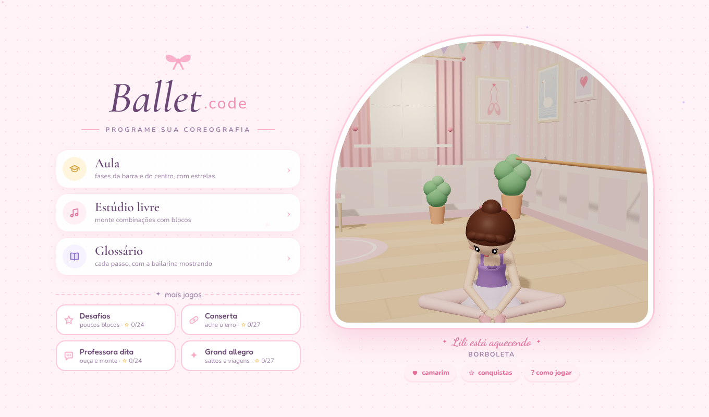
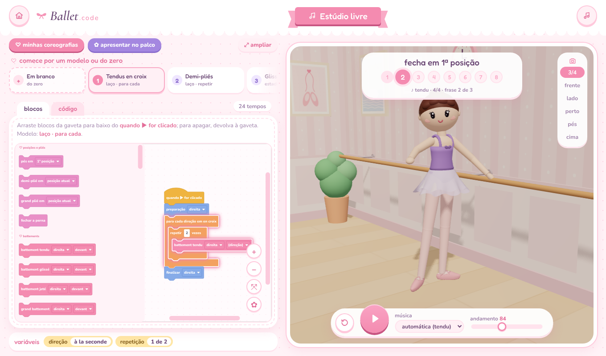

# Ballet.code 🩰

**Aprenda a programar montando coreografias de ballet.**

Ballet.code é um jogo de programação em blocos, no estilo do Scratch, em que você monta combinações de ballet e
uma bailarina 3D dança exatamente o que o seu programa manda, no tempo da música. Os passos seguem o método RAD,
com os nomes em francês, e uma professora confere se a sua combinação ficou igual ao exemplo.

**[▶ Jogar agora](https://ballet-code-jgm8.vercel.app)**: funciona direto no navegador, no computador, no tablet e no celular. Não precisa instalar nada.



## Como funciona

Você arrasta os passos (pliés, tendus, piruetas, saltos...) para baixo do bloco **quando ▶ for clicado** e aperta o
play. A bailarina dança a sequência na ordem, contando os tempos de 1 a 8, como numa aula de verdade.

Se algo não estiver certo no ballet, a professora avisa antes de dançar: perna errada na barra, pé de trás
saindo para a frente, passo que precisa da 5ª posição. Assim você aprende programação e ballet ao mesmo tempo.



## Modos de jogo

| Modo | O que é |
| --- | --- |
| **Aula** | Fases da barra e do centro, na ordem de uma aula RAD. Cada fase vale até 3 estrelas. |
| **Desafios** | Combinações conhecidas com poucos blocos ou com um bloco proibido. |
| **Conserta** | A combinação vem montada com um erro: encontre e conserte. |
| **Professora dita** | A professora fala a combinação, como em aula, e você monta de ouvido. |
| **Grand allegro** | Saltos grandes e passos que viajam pela sala, incluindo as diagonais. |
| **Estúdio livre** | Crie suas próprias coreografias do zero ou a partir de modelos. |
| **Palco** | Apresente sua coreografia num teatro, com cortina, canhão de luz, flores e aplausos. |

## O que dá para aprender

**Programação**
- Sequência: os passos acontecem na ordem em que estão.
- Laços: `repetir` e `para cada` (por exemplo, um tendu en croix em quatro direções com um bloco só).
- Funções com parâmetro: crie um passo seu e use com a perna direita ou esquerda.
- Depuração: encontre o erro nas fases do modo Conserta.
- Editor de texto: o mesmo programa também pode ser escrito como código.

**Ballet**
- Posições dos pés e dos braços do RAD.
- Barra: pliés, tendus, glissés, jetés, rond de jambe, fondu, frappé, développé, grand battement e mais.
- Centro: direções do corpo, arabesques, attitude, penché e révérence.
- Saltos, giros e deslocamentos: sauté, échappé, assemblé, glissade, pas de bourrée, piruetas, fouettés, grand jeté.
- Os 8 pontos da sala e as diagonais.

## Mais coisas

- **Glossário** com mais de 60 termos: a bailarina demonstra cada passo.
- **Camarim** para escolher o cabelo, o collant, a saia, a sapatilha e os enfeites. Com 50 estrelas, libera a
  sapatilha de ponta.
- **Conquistas** ao longo do jogo.
- **Músicas originais** compostas para o jogo e geradas no próprio navegador. Também dá para usar uma música sua.
- **Salvar, baixar e abrir coreografias.** Tudo fica guardado no seu navegador.

## Rodar no seu computador

Você precisa do [Node.js](https://nodejs.org) instalado.

```bash
git clone https://github.com/cibellyhnb/ballet-code.git
cd ballet-code
npm install
npm run dev
```

Depois abra http://localhost:5173 no navegador.

Outros comandos:

```bash
npm run build        # gera o site estático em dist/
npm run build:single # gera um único index.html com tudo embutido
```

## Feito com

[React](https://react.dev), [TypeScript](https://www.typescriptlang.org), [Vite](https://vite.dev),
[Three.js](https://threejs.org) com [React Three Fiber](https://r3f.docs.pmnd.rs) (a bailarina e a sala 3D),
[Blockly](https://developers.google.com/blockly) (o editor de blocos) e [Zustand](https://zustand.docs.pmnd.rs).
A música é feita com a Web Audio API. As fontes (Fredoka, Nunito, Cormorant Garamond e Dancing Script) vêm do
Google Fonts e estão embutidas no projeto.

## Organização do código

```
src/
  engine/      o motor: estado do corpo, bailarina 3D, compilador dos blocos e leitor do código em texto
  blocks/      os blocos do editor e a conversão entre blocos e programa
  data/        fases de cada modo, glossário e conquistas
  screens/     as telas do jogo
  components/  cena 3D, palco, editor de blocos e janelas
  audio.ts     música e efeitos sonoros
tools/         testes automáticos
docs/          imagens deste README
```

## Testes

Testes que rodam no terminal:

```bash
npx tsx tools/fases.test.ts     # o texto de cada fase pede exatamente o que o exemplo faz
npx tsx tools/scan.test.ts      # mais de 140 combinações sem pé atravessando o chão nem trancos
```

Também há testes no navegador, em Python com Playwright, na pasta `tools/`. Rode `npm run build:single` antes.